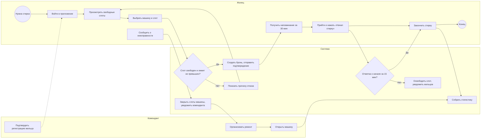

# laundry-dormitory
# Концепция информационной системы

**Практическая работа № 2**

**Дисциплина:** Проектирование информационных систем

**Тема:** Бронирование стиральных машин в общежитии

## Состав команды и распределение ролей

| Участник | Учебная группа | 
|---|---|
| Нгуен Динь Нам | K3340 |
| Субагио Сатрио Брахманторо Ади | K3340 | 

## Содержание

- [Цель и задачи работы](#цель-и-задачи-работы)
- [1. Характеристика объекта автоматизации и требования пользователя](#1-характеристика-объекта-автоматизации-и-требования-пользователя)
- [2. Аналитический обзор аналогов и готовых решений](#2-аналитический-обзор-аналогов-и-готовых-решений)
- [3. Альтернативные варианты концепции ИС](#3-альтернативные-варианты-концепции-ис)
- [4. Сравнение вариантов и обоснование выбора](#4-сравнение-вариантов-и-обоснование-выбора)
- [5. Описание выбранной концепции и модель процессов TO-BE](#5-описание-выбранной-концепции-и-модель-процессов-to-be)
- [6. Ожидаемые эффекты и технико-экономическое обоснование](#6-ожидаемые-эффекты-и-технико-экономическое-обоснование)
- [7. Реестр рисков и меры реагирования](#7-реестр-рисков-и-меры-реагирования)
- [8. Порядок оценки качества и условия приёмки](#8-порядок-оценки-качества-и-условия-приёмки)
- [9. Выводы](#9-выводы)
- [Список источников](#список-источников)
- [Приложения](#приложения)

## Цель и задачи работы

**Цель работы** — разработать концепцию информационной системы бронирования стиральных машин в общежитии и обосновать выбор подходящего варианта организации записи на стирку с учётом требований пользователей, затрат, ожидаемых эффектов и рисков.

Для достижения поставленной цели необходимо решить следующие задачи:

1. Описать объект автоматизации, участников и текущий процесс использования стиральных машин. Определить основные проблемы, сформулировать функциональные и нефункциональные требования, ограничения и обязательные требования Must.

2. Провести аналитический обзор 3–5 аналогов или готовых решений, включая отечественные. Сравнить их по функциям, модели лицензирования, стоимости, возможностям интеграции и размещения данных.

3. Разработать не менее трёх альтернативных вариантов концепции, включая организационное решение без создания новой ИС. Для каждого варианта определить состав функций, технологическую основу, необходимые ресурсы, сроки, затраты, достоинства и недостатки.

4. Сопоставить варианты с требованиями пользователей. Согласовать с заказчиком критерии и веса, выполнить многокритериальную оценку, проверить устойчивость выбора и обосновать выбранный вариант.

5. Построить модель целевого процесса TO-BE в нотации BPMN 2.0. Показать изменения по сравнению с AS-IS и определить, какие действия автоматизируются, а какие остаются за пользователями и сотрудниками общежития.

6. Оценить экономическую целесообразность выбранного варианта: рассчитать совокупную стоимость владения за три года, годовой эффект, срок окупаемости и ROI. Определить 3–5 неденежных эффектов и показатели для их измерения.

7. Составить реестр из 7–10 рисков проекта, оценить их вероятность и влияние, выбрать стратегии реагирования, предложить конкретные меры и назначить ответственных.

8. Определить 5–7 измеримых показателей качества и порядок приёмки системы, включая виды испытаний, участников и итоговые документы.

9. Подготовить дорожную карту реализации выбранного варианта и оформить результаты анализа в виде отчёта с обоснованными выводами.

## 1. Характеристика объекта автоматизации и требования пользователя

### 1.1. Объект автоматизации

Объект автоматизации — процесс записи на стирку и использования общих стиральных машин в общежитии.

**Условия и допущения** (приняты командой как рабочие до уточнения у преподавателя):

| Параметр | Значение |
|---|---|
| Число жильцов (пользователей) | ~300 |
| Число стиральных машин | 4 |
| Длительность слота | 2 часа |
| Время работы прачечной | 08:00–24:00 (8 слотов на машину в сутки, 32 слота в сутки) |
| Одновременная нагрузка на систему | до 50 пользователей |
| Бюджет создания | не более 600 тыс. руб. |
| Срок ввода в эксплуатацию | не более 4 месяцев |
| Размещение данных | только серверы на территории РФ (152-ФЗ) |

**Участники процесса:**

| Участник | Роль в процессе |
|---|---|
| Жилец | Записывается на стирку, пользуется машиной, сообщает о неисправностях |
| Комендант / дежурный | Контролирует порядок, разбирает конфликты, организует ремонт |
| Технический персонал | Ремонтирует и обслуживает машины |
| Администрация общежития / вуза | Утверждает правила, отвечает за обработку персональных данных |

### 1.2. Проблемы AS-IS

Текущий процесс: запись ведётся на бумажном листе у прачечной или в мессенджер-чате, комендант вручную разрешает споры.

| № | Проблема | Последствие |
|---|---|---|
| П1 | Запись на бумаге или в чате: данные неактуальны, нет единого источника | Жильцы приходят и не находят свободной машины |
| П2 | Конфликты из-за одного и того же времени, нет правил и приоритетов | Споры, нагрузка на коменданта |
| П3 | Неявки: слот занят, но не используется, и его нельзя освободить | Простой машин, потеря времени других жильцов |
| П4 | Нет информации о неисправных машинах на момент записи | Напрасные походы, задержка ремонта |
| П5 | Нет статистики загрузки и поломок | Решения о ремонте и закупке принимаются без данных |
| П6 | Нет проверки, что записывается проживающий в общежитии | Использование машин посторонними, нарушение очереди |

### 1.3. Требования пользователя

| ID | Тип | Требование | Приоритет | Решает проблему |
|---|---|---|---|---|
| R1 | Функц. | Просмотр свободных и занятых слотов по каждой машине | должен | П1 |
| R2 | Функц. | Бронирование и отмена слота жильцом | должен | П1, П2 |
| R3 | Нефункц. | Доступ с мобильного телефона без установки сложного ПО | должен | П1 |
| R4 | Огранич. | Хранение персональных данных только на серверах РФ (152-ФЗ) | должен | — |
| R5 | Нефункц. | Время отклика интерфейса не более 2 с при 50 одновременных пользователях | должен | — |
| R6 | Функц. | Уведомления о предстоящем слоте и об освобождении слота | Следовало бы | П3 |
| R7 | Функц. | Защита от двойной записи, лимит бронирований на жильца, автоосвобождение слота при неявке | Следовало бы | П2, П3 |
| R8 | Функц. | Отметка о неисправности машины и закрытие её слотов | Следовало бы | П4 |
| R9 | Функц. | Статистика загрузки и поломок для коменданта | Мог бы | П5 |
| R10 | Функц. | Идентификация жильца (только проживающие могут бронировать) | Следовало бы | П6 |

**Обязательные требования (Must):** R1–R5. Варианты, не выполняющие хотя бы одно из них, исключаются из сравнения.

---

## 2. Аналитический обзор аналогов и готовых решений

### 2.1. Сравнение аналогов

| Аналог | Тип | Основные функции | Лицензирование / стоимость | Интеграции | Размещение данных |
|---|---|---|---|---|---|
| Яндекс Формы + Яндекс 360 Таблицы | Облачные офисные инструменты | Форма записи, таблица занятости | Бесплатный или недорогой тариф [проверить] | Ограниченные (почта, API Яндекса) | Серверы РФ (проверить условия) |
| YCLIENTS | Российский SaaS онлайн-записи | Виджет записи, ресурсы (машины как «мастера»), напоминания | Подписка, ориентировочно единицы тыс. руб./мес. [проверить] | API, мессенджеры, платные SMS | РФ [проверить] |
| Битрикс24 (онлайн-запись, ресурсы) | Российская бизнес-платформа | Бронирование ресурсов, CRM, задачи | Тарифы по числу пользователей [проверить] | Широкие (REST API) | РФ [проверить] |
| Calendly / Google Calendar (запись на приём) | Зарубежный SaaS | Календарь, запись, напоминания | Бесплатный и платные тарифы | Широкие | За пределами РФ, не соответствует R4 |
| Конструктор чат-ботов (например, Salebot) | Low-code / no-code | Бот записи, уведомления | Подписка [проверить] | Мессенджеры, webhook | РФ [проверить] |

### 2.2. Выводы обзора

1. Ни один аналог не создан специально для общежитий: машины приходится «притягивать» к моделям услуг (ресурс, мастер), а правила общежития (лимиты, проверка проживания, неявки) требуют настройки или не реализуются.
2. Зарубежные сервисы (Calendly, Google) не проходят Must R4 и исключаются из дальнейшего сравнения как самостоятельные решения.
3. Российские SaaS (YCLIENTS, Битрикс24) закрывают базовое бронирование и напоминания, но дают слабую интеграцию с учётными записями вуза и зависимость от тарифов поставщика.
4. Простые облачные таблицы дают минимальную стоимость, но не обеспечивают автоматического контроля конфликтов, уведомлений и идентификации жильцов.

---

## 3. Альтернативные варианты концепции ИС

### 3.1. Описание вариантов

| Параметр | Вариант A — организационный (нулевой) | Вариант B — готовое облачное решение (SaaS) | Вариант C — собственная разработка |
|---|---|---|---|
| Идея решения | Единая облачная таблица с формой записи и регламент использования машин | Настройка российского SaaS онлайн-записи: машины как ресурсы, виджет записи, напоминания | Веб-приложение (PWA) для бронирования с правилами общежития, аутентификацией жильцов и панелью коменданта |
| Автоматизируемые функции | R1, R2 (форма и таблица); R9 частично (формулы) | R1, R2, R6; R7, R8, R9, R10 частично (стандартные средства) | R1–R10 |
| Архитектура и технологии | Яндекс Формы и Таблицы, регламент в виде документа | SaaS-платформа, виджет на странице общежития, рассылка напоминаний | SPA/PWA (React), REST API (Python/FastAPI или Node.js), PostgreSQL, очередь уведомлений, хостинг в РФ (Yandex Cloud, Selectel, VK Cloud и аналоги), адаптер уведомлений (e-mail + мессенджер) |
| Команда и трудоёмкость | 1 чел., 0,3 чел.-мес. | 1 чел., 1,0 чел.-мес. | 2–3 чел., 5,0 чел.-мес. |
| Стоимость создания, тыс. руб. | 30 | 100 | 495 |
| Эксплуатация в год, тыс. руб. | 10 | 96 | 90 |
| Срок ввода, мес. | 0,5 | 1,5 | 4 |
| Достоинства | Минимальные затраты, запуск за дни, нет зависимости от разработчиков | Быстрый запуск, готовые напоминания и отчёты, поддержка поставщика | Полное покрытие требований, правила общежития, контроль над данными и ПДн, возможность интеграции с учётной записью вуза |
| Недостатки | Нет контроля конфликтов, уведомлений, идентификации; зависит от дисциплины жильцов; ручной труд коменданта | Подписка, ограниченная настройка правил, зависимость от поставщика, ПДн у третьей стороны, слабая интеграция с вузом | Наибольшие затраты и срок, риски разработки, нужна поддержка после запуска |

### 3.2. Обоснование оценок ресурсов

Допущения: ставка 80 тыс. руб. за чел.-мес. (с налогами); ставка коменданта 400 руб./ч. Цены хостинга и подписок — ориентировочные, подлежат проверке.

| Вариант | Состав стоимости создания | Состав стоимости эксплуатации в год |
|---|---|---|
| A | 0,3 чел.-мес. × 80 = 24; регламент и обучение жильцов 6 → **30** | Администрирование таблицы 10 → **10** |
| B | Настройка 1,0 чел.-мес. × 80 = 80; подключение, первичные рассылки 20 → **100** | Подписка 5 × 12 = 60; поддержка 36 → **96** |
| C | Разработка 5,0 чел.-мес. × 80 = 400; инфраструктура и ИБ-проверка 30; резерв 15% от 430 ≈ 65 → **495** | Хостинг 2 × 12 = 24; сопровождение 60; домен, сертификаты, резервное копирование 6 → **90** |

Распределение трудоёмкости варианта C (5,0 чел.-мес.): аналитика и проектирование — 0,8; backend — 1,6; frontend — 1,2; тестирование — 0,8; ИБ и нагрузочные испытания — 0,4; внедрение и обучение — 0,2.

---

## 4. Сравнение вариантов и обоснование выбора

Матрица соответствия «требование × вариант»: ● — выполняется, ◐ — частично, ○ — не выполняется.

| Требование | Приоритет | A | B | C |
|---|---|---|---|---|
| R1. Просмотр слотов | Must | ● | ● | ● |
| R2. Бронирование и отмена | Must | ● | ● | ● |
| R3. Доступ с телефона | Must | ● | ● | ● |
| R4. ПДн на серверах РФ | Must | ● | ●* | ● |
| R5. Отклик ≤ 2 с при 50 пользователях | Must | ● | ● | ● |
| R6. Уведомления | Should | ○ | ● | ● |
| R7. Защита от двойной записи, лимиты, автоосвобождение | Should | ○ | ◐ | ● |
| R8. Отметка о неисправности | Should | ◐ | ◐ | ● |
| R9. Статистика | Could | ◐ | ◐ | ● |
| R10. Идентификация жильца | Should | ○ | ◐ | ● |

\* При условии выбора поставщика с центрами обработки данных в РФ и заключения договора поручения на обработку ПДн.

Все три варианта выполняют Must-требования, поэтому остаются в сравнении. Различия — в Should и Could.

### 4.2. Критерии и веса

Критерии и веса согласованы с «заказчиком» до расчёта оценок [указать дату и участников согласования, приложить протокол в Приложении Б].

| Критерий | Вес | Обоснование веса |
|---|---|---|
| Покрытие требований | 0,25 | Главная цель проекта — снять проблемы П1–П6 |
| Стоимость владения за 3 года | 0,20 | Бюджет ограничен |
| Безопасность, 152-ФЗ | 0,15 | Обрабатываются ПДн жильцов |
| Срок ввода | 0,10 | Эффект нужен в текущем учебном году |
| Интеграция | 0,10 | Связь с учётной записью вуза и каналами уведомлений |
| Удобство пользователей | 0,10 | Система работает только при массовом использовании жильцами |
| Масштабируемость | 0,05 | Рост числа машин и корпусов |
| Зависимость от поставщика | 0,05 | Риск блокировки и роста тарифов |
| **Сумма** | **1,00** | |

### 4.3. Шкала оценок (1–5)

- **Стоимость владения за 3 года:** A (60 тыс.) — 5; B (388 тыс.) — 4; C (765 тыс.) — 2.
- **Срок ввода:** A (0,5 мес.) — 5; B (1,5 мес.) — 4; C (4 мес.) — 2.
- Остальные критерии — экспертная оценка команды.

### 4.4. Таблица взвешенных оценок

| Критерий | Вес | A | B | C |
|---|---|---|---|---|
| Покрытие требований | 0,25 | 2 | 4 | 5 |
| Стоимость владения за 3 года | 0,20 | 5 | 4 | 2 |
| Безопасность, 152-ФЗ | 0,15 | 2 | 3 | 4 |
| Срок ввода | 0,10 | 5 | 4 | 2 |
| Интеграция | 0,10 | 1 | 3 | 5 |
| Удобство пользователей | 0,10 | 2 | 4 | 5 |
| Масштабируемость | 0,05 | 1 | 4 | 4 |
| Зависимость от поставщика | 0,05 | 3 | 2 | 4 |
| **Итог Sᵢ** | **1,00** | **2,80** | **3,65** | **3,85** |

Пример расчёта для варианта C:  
S(C) = 0,25·5 + 0,20·2 + 0,15·4 + 0,10·2 + 0,10·5 + 0,10·5 + 0,05·4 + 0,05·4 = 1,25 + 0,40 + 0,60 + 0,20 + 0,50 + 0,50 + 0,20 + 0,20 = **3,85**.

### 4.5. Проверка устойчивости

Самый значимый критерий — «Покрытие требований» (0,25). Вес меняется на ±0,05 с компенсацией за счёт критерия, на котором конкурент B сильнее всего опережает C (стоимость владения, разрыв в 2 балла).

| Сценарий | S(A) | S(B) | S(C) | Лидер |
|---|---|---|---|---|
| Базовый | 2,80 | 3,65 | 3,85 | C |
| Покрытие 0,20; стоимость 0,25 | 2,85 | 3,65 | 3,70 | C (запас 0,05) |
| Покрытие 0,30; стоимость 0,15 | 2,75 | 3,65 | 4,00 | C |

**Вывод:** при изменении веса ±0,05 лидер не меняется, но при худшем сценарии отрыв C от B составляет всего 0,05. Лидерство C сохраняется, пока сдвиг веса из «Покрытия» в «Стоимость» не превышает ≈ 0,067; при большем сдвиге лидером становится вариант B. Выбор C **условно устойчив** и чувствителен к весу стоимости. Это отмечено в выводах и в рисках (раздел 7).

### 4.6. Решение

Выбирается **вариант C — собственная разработка (PWA) с поэтапным запуском: сначала MVP (R1–R3, R6, R7, R10), затем R8, R9**. Вариант B принимается как резервный: он реализуется, если бюджет окажется менее 500 тыс. руб. или срок — менее 3 месяцев.

---

## 5. Описание выбранной концепции и модель процессов TO-BE

### 5.4. Какие проблемы AS-IS устраняются

| Проблема | Изменение в TO-BE |
|---|---|
| П1. Данные неактуальны | Единое расписание в реальном времени, доступное с телефона |
| П2. Конфликты по времени | Система не допускает двойной записи; правила и лимиты зашиты в бизнес-логику |
| П3. Неявки | Напоминание за 30 мин, отметка о начале, автоосвобождение слота через 15 мин |
| П4. Неизвестные неисправности | Жилец или комендант отмечает поломку, слоты машины закрываются автоматически |
| П5. Нет статистики | Панель коменданта: загрузка, неявки, поломки по периодам |
| П6. Нет проверки проживания | Регистрация с подтверждением комендантом (затем учётная запись вуза) |

### 5.5. Границы системы

| Шаг процесса | Автоматизируется | Остаётся ручным |
|---|---|---|
| Просмотр расписания, бронирование, отмена | Да | — |
| Проверка конфликтов и лимитов | Да | — |
| Напоминания и освобождение слота при неявке | Да | — |
| Регистрация жильца | Частично (форма) | Подтверждение комендантом |
| Физическое использование машины | — | Да |
| Ремонт машин | — | Да (система только фиксирует и уведомляет) |
| Разбор спорных ситуаций | — | Да (комендант, с опорой на журнал событий) |

### 5.6. Что переходит в ТЗ

Из концепции в техническое задание (следующая практическая работа) переходят: требования R1–R10 с приоритетами, границы системы, архитектурный принцип, показатели качества из раздела 8 и условия приёмки.

### 5.7. Дорожная карта реализации

| Этап | Срок | Содержание | Результат |
|---|---|---|---|
| 1. Подготовка | Месяц 1 | Согласование ПДн и доступа к учётной записи вуза; прототип экранов; ТЗ | Утверждённое ТЗ, согласованный регламент |
| 2. Ядро (MVP) | Месяц 2 | Backend, БД, регистрация, бронирование, правила | Работающий API и базовый клиент |
| 3. Расширение | Месяц 3 | Уведомления, неисправности, статистика, ИБ-проверка, нагрузочные испытания | Версия для опытной эксплуатации |
| 4. Опытная эксплуатация | Месяц 4 | Пилот в общежитии 4 недели, обучение, исправление замечаний | Акт приёмки, регламент использования |
| 5. Сопровождение | После месяца 4 | Поддержка, сбор KPI, развитие | Ежеквартальный отчёт по KPI |

Контрольная точка принятия решения: по итогам этапа 1, если бюджет или срок сокращены, переход на вариант B (см. п. 4.6).

---

## 6. Ожидаемые эффекты и технико-экономическое обоснование

### 6.1. Допущения

| Параметр | Значение | Источник |
|---|---|---|
| Учебных недель в году | 42 | Календарный график вуза [проверить] |
| Время коменданта на запись и разбор конфликтов (AS-IS) | 10 ч/нед. | Оценка команды [подтвердить опросом коменданта] |
| То же после внедрения (TO-BE) | 2 ч/нед. | Оценка команды |
| Стоимость часа коменданта | 400 руб. | Допущение |
| Потери времени жильцов (напрасные визиты, споры) | 0,5 ч/мес. на жильца × 9 мес. × 300 чел. = 1 350 ч/год | Оценка команды [подтвердить опросом жильцов] |
| Условная стоимость часа жильца | 150 руб. | Допущение (условная оценка) |
| Сокращение потерь от простоя и аварий | 25 тыс. руб./год | Оценка команды |

### 6.2. Потенциальный годовой эффект

| Статья | Расчёт | Сумма, тыс. руб./год |
|---|---|---|
| Экономия времени коменданта | (10 − 2) × 42 × 400 = 134 400 руб. | 134 |
| Экономия времени жильцов (условная) | 1 350 × 150 = 202 500 руб. | 203 |
| Сокращение потерь от простоя и аварий | оценка | 25 |
| **Итого потенциал** | | **≈ 362 (≈ 360 принято для расчёта)** |

Доля реализации потенциала зависит от охвата требований (по матрице 4.1):

| Вариант | Доля реализации | Годовой эффект E, тыс. руб. |
|---|---|---|
| A | 35% | 126 |
| B | 75% | 270 |
| C | 90% | 324 |

### 6.3. TCO, окупаемость и ROI за 3 года

Формулы: TCO = C_созд + Σ C_экспл,t; T_ок = C_созд / (E − C_экспл); ROI = (Σ E_t − TCO) / TCO · 100%.

| Показатель | A | B | C |
|---|---|---|---|
| C_созд, тыс. руб. | 30 | 100 | 495 |
| C_экспл в год, тыс. руб. | 10 | 96 | 90 |
| **TCO за 3 года, тыс. руб.** | 30 + 3·10 = **60** | 100 + 3·96 = **388** | 495 + 3·90 = **765** |
| Годовой эффект E, тыс. руб. | 126 | 270 | 324 |
| E − C_экспл, тыс. руб./год | 116 | 174 | 234 |
| **Срок окупаемости T_ок** | 30/116 ≈ 0,26 г. (≈ 3 мес.) | 100/174 ≈ 0,57 г. (≈ 7 мес.) | 495/234 ≈ 2,1 г. (≈ 25 мес.) |
| Эффект за 3 года, тыс. руб. | 378 | 810 | 972 |
| **ROI за 3 года** | (378 − 60)/60 ≈ **530%** | (810 − 388)/388 ≈ **109%** | (972 − 765)/765 ≈ **27%** |

### 6.4. Анализ чувствительности и честная оценка

1. Вариант C — самый дорогой, у него самый низкий ROI (27%) и окупаемость около 2 лет. Он выбран по многокритериальной оценке из-за полноты покрытия требований, контроля над ПДн и интеграции, а не из-за экономики.
2. Вариант C окупается за 3 года, только если годовой эффект E ≥ 255 тыс. руб. (3·(E − 90) ≥ 495), то есть при реализации не менее ≈ 71% потенциала. Планируется 90%. При реализации 70% (E ≈ 227 тыс. руб.) ROI за 3 года отрицательный (≈ −11%).
3. Вариант A экономически наиболее выгоден, но не закрывает проблемы П2, П3, П6 (см. матрицу 4.1) и поэтому не обеспечивает цели проекта.
4. Часть эффекта (время жильцов) — условная и не даёт реальной экономии бюджета; без неё денежный эффект C составил бы ≈ 159 тыс. руб./год, а окупаемость превысила бы 3 года. Это ограничение необходимо озвучить заказчику.
5. Для снижения риска предлагается этап MVP и контрольная точка перехода на вариант B.

### 6.5. Неденежные эффекты и KPI

| Эффект | KPI | Целевое значение | Способ измерения |
|---|---|---|---|
| Прозрачность очереди | Доля бронирований, видимых онлайн | 100% | Отчёт системы |
| Меньше конфликтов | Число обращений к коменданту по спорам | −70% к базовому уровню [измерить до запуска] | Журнал обращений |
| Сокращение неявок | Доля слотов без отметки о начале | ≤ 10% через 3 месяца | Статистика системы |
| Оперативность по неисправностям | Время от сообщения до закрытия машины | ≤ 1 ч | Журнал событий |
| Удовлетворённость жильцов | Индекс SUS | ≥ 70 | Опрос 30+ жильцов через 2 месяца |

---

## 7. Реестр рисков и меры реагирования

Уровень риска R = P · I (P — вероятность, I — влияние, шкала 1–5). Высокий: 15–25; средний: 8–14; низкий: 1–7.

| № | Риск | Категория | P | I | R | Уровень | Стратегия | Меры | Ответственный |
|---|---|---|---|---|---|---|---|---|---|
| 1 | Задержка или отказ в доступе к API единой учётной записи вуза | Технический / организационный | 4 | 3 | 12 | Средний | Снизить | Раннее согласование с ИТ-службой; регистрация с подтверждением комендантом как запасной путь | Руководитель проекта |
| 2 | Низкая вовлечённость жильцов (продолжают писать в чат) | Организационный | 3 | 4 | 12 | Средний | Снизить | Информирование, простой вход с телефона, правило «в чате не записываем», поддержка старост этажей | Аналитик, комендант |
| 3 | Превышение бюджета или срока разработки | Финансовый | 3 | 3 | 9 | Средний | Снизить | Резерв 15%, MVP, контрольная точка перехода на вариант B | Руководитель проекта |
| 4 | Нарушение 152-ФЗ (избыточные ПДн, нет согласия, хранение вне РФ) | Правовой | 2 | 5 | 10 | Средний | Избежать / снизить | Минимизация данных (ФИО, комната, контакт), согласие на обработку, хостинг в РФ, проверка необходимости уведомления Роскомнадзора, назначение оператора ПДн | Специалист по ИБ, юрист вуза |
| 5 | Утечка данных или несанкционированный доступ | Информационная безопасность | 3 | 5 | 15 | Высокий | Снизить | Разграничение ролей, TLS, хеширование паролей, журналирование, резервные копии, проверка по OWASP ASVS (уровень 1) | Специалист по ИБ |
| 6 | Недоступность канала уведомлений (мессенджер) | Внешний / технический | 3 | 3 | 9 | Средний | Снизить | Адаптер уведомлений, дублирование по e-mail, основной интерфейс — PWA | Архитектор |
| 7 | Нехватка времени или выбытие участника команды | Организационный | 4 | 4 | 16 | Высокий | Снизить | Документирование, код-ревью, MVP, распределение ролей с дублированием, запас по срокам | Руководитель проекта |
| 8 | Администрация не согласует размещение ПДн или правила использования | Правовой / организационный | 3 | 4 | 12 | Средний | Снизить | Ранняя встреча с администрацией, утверждение регламента и политики ПДн до разработки | Руководитель проекта |
| 9 | Сбой системы или потеря данных | Технический | 2 | 4 | 8 | Средний | Снизить | Ежедневные резервные копии, мониторинг, запасной ручной режим записи (вариант A) | Архитектор |
| 10 | Злоупотребление: бронь «про запас», несколько аккаунтов | Организационный | 4 | 2 | 8 | Средний | Снизить | Лимит броней, автоосвобождение, штрафные ограничения при неявках, подтверждение жильцов | Аналитик, комендант |

Для рисков 5 и 7 (высокий уровень) обязательны меры предотвращения и план реагирования, они включены в дорожную карту.

---

## 8. Порядок оценки качества и условия приёмки

### 8.1. Показатели качества

| № | Показатель | Целевое значение | Способ проверки |
|---|---|---|---|
| 1 | Время регистрации бронирования (от открытия приложения) | ≤ 1 мин для 90% пользователей | Хронометраж на 20 пользователях |
| 2 | Время отклика интерфейса | ≤ 2 с (95-й перцентиль) при 50 одновременных пользователях | Нагрузочное тестирование (JMeter или k6) |
| 3 | Двойные бронирования одного слота | 0 при 1 000 параллельных запросов | Автоматизированный тест |
| 4 | Своевременность уведомлений | ≥ 95% доставлено не позднее чем за 25 мин до слота | Анализ журнала уведомлений |
| 5 | Доля слотов с неявкой | ≤ 10% через 3 месяца эксплуатации | Отчёт системы |
| 6 | Уязвимости высокого и критического уровня | 0 по чек-листу OWASP ASVS (уровень 1) | Проверка безопасности специалистом по ИБ |
| 7 | Удобство использования | SUS ≥ 70 | Опрос не менее 30 жильцов |

### 8.2. Укрупнённый порядок приёмки

| Вид испытаний | Содержание | Участники | Итоговый документ |
|---|---|---|---|
| Предварительные | Функциональные, нагрузочные, проверка безопасности на тестовом стенде | Команда проекта, специалист по ИБ | Протокол предварительных испытаний |
| Опытная эксплуатация | 4 недели в общежитии; сбор замечаний и KPI | Комендант, старосты, жильцы, команда | Журнал замечаний, протокол опытной эксплуатации |
| Приёмочные | Проверка показателей 1–7, сверка с требованиями R1–R10 | Заказчик (преподаватель), комендант, команда | Программа и методика испытаний, протокол испытаний, акт приёмки |

Условие приёмки: выполнены все Must-требования (R1–R5) и показатели 1–3, 6; остальные показатели либо достигнуты, либо по ним утверждён план доработки с датой.

Показатели раздела 8 переходят в раздел «Требования к качеству» технического задания на следующей практической работе.

---

## 9. Выводы

1. Объект автоматизации — запись на стирку в общежитии (~300 жильцов, 4 машины). Выявлены шесть проблем AS-IS, сформулированы десять требований, из них пять обязательных.
2. Рассмотрены три содержательно разных варианта: организационный (A), готовое SaaS-решение (B) и собственная разработка (C). Зарубежные аналоги не соответствуют требованию размещения ПДн в РФ.
3. По методу взвешенных оценок лидирует вариант C (3,85), затем B (3,65) и A (2,80). Выбор устойчив при изменении веса ±0,05, но запас мал (0,05), и лидерство зависит от веса стоимости. Это существенное ограничение вывода.
4. Экономически вариант C самый слабый: TCO за 3 года — 765 тыс. руб., окупаемость ≈ 2,1 года, ROI ≈ 27%. Он окупается за 3 года только при реализации не менее ≈ 71% потенциального эффекта. Варианты A и B имеют лучшие показатели ROI, но хуже закрывают требования.
5. Предложена модель TO-BE, в которой устраняются все проблемы П1–П6; ручными остаются регистрация жильцов (подтверждение), ремонт и разбор спорных ситуаций.
6. Реестр содержит 10 рисков; высокий уровень у утечки данных (15) и нехватки ресурсов команды (16). Для них предусмотрены меры предотвращения.
7. Определены 7 показателей качества и порядок приёмки; они станут основой ТЗ.
8. **Рекомендация:** реализовать вариант C поэтапно (MVP, затем расширение) с контрольной точкой на месяце 1. Если бюджет окажется менее 500 тыс. руб. или срок менее 3 месяцев, перейти на вариант B.

---

## Список источников

## Приложения