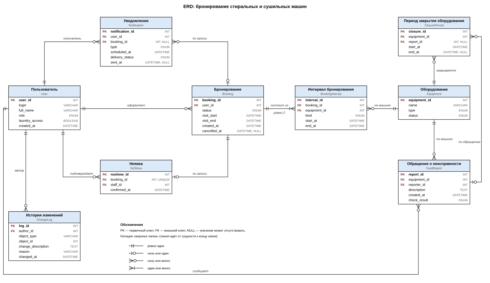
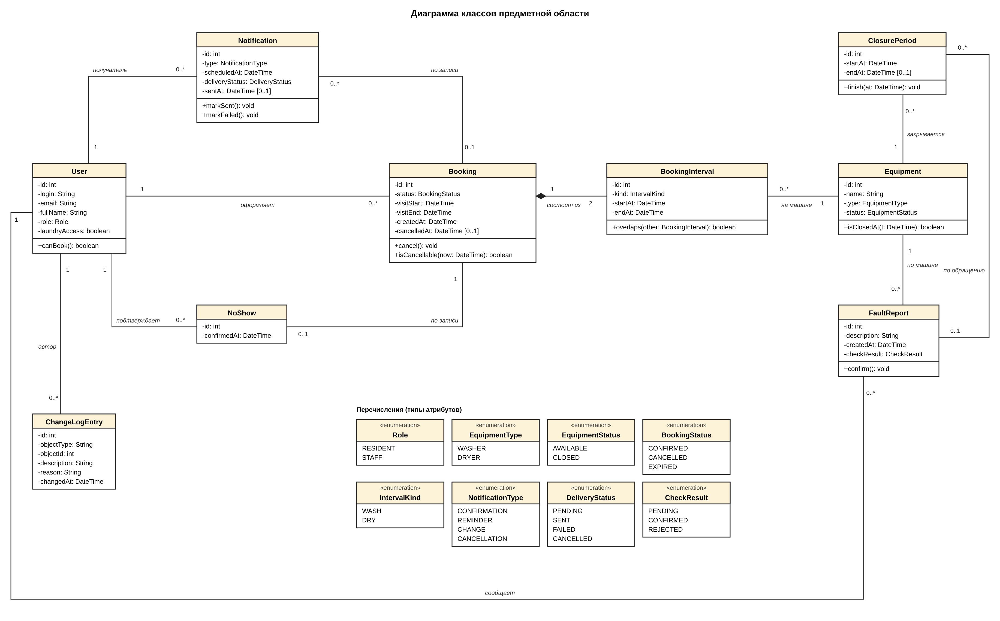
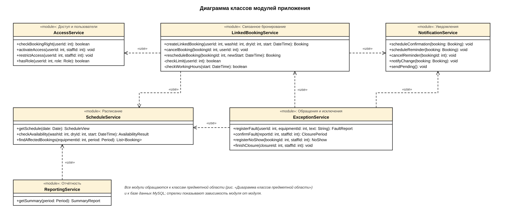

## 1. Диаграмма вариантов использования

### 1.1. Назначение и границы системы

В этой части работы мы описываем взаимодействие пользователей с системой бронирования стиральных и сушильных машин в общежитии. За основу берём требования R1–R16 из работы № 2 и уточнённые процессы TO-BE из работы № 3.

Границу системы обозначаем как «ИС бронирования стиральных и сушильных машин». В неё включаем просмотр расписания, оформление и отмену связанных записей, управление правом пользования прачечной, обработку неявок и неисправностей, уведомления и предоставление сводных данных.

При этом одно бронирование объединяет 80 минут стирки и следующие за ними 40 минут сушки. Физическое использование и ремонт машин остаются за пределами информационной системы.

### 1.2. Действующие лица

В модели мы выделяем два действующих лица.

| Действующее лицо | Описание |
|---|---|
| Жилец | Просматривает расписание, оформляет и отменяет собственные записи, сообщает о неисправностях |
| Ответственный сотрудник | Управляет правом пользования прачечной, обрабатывает неявки и неисправности, просматривает сводные данные |

Под ответственным сотрудником понимаем коменданта или дежурного из предыдущих работ.

Технический персонал ремонтирует оборудование и сообщает результат сотруднику. Поскольку отдельный доступ к системе для него не предусматриваем, на диаграмме его не показываем.

*Рисунок 1 — Диаграмма вариантов использования системы бронирования стиральных и сушильных машин.*

### 1.3. Варианты использования

Для каждого действующего лица определяем доступные функции и результат их выполнения.

| Код | Название | Действующее лицо | Результат |
|---|---|---|---|
| UC1 | Просмотреть расписание | Жилец, Ответственный сотрудник | Показаны свободные, занятые и недоступные интервалы оборудования |
| UC2 | Оформить связанную запись | Жилец | Подтверждено бронирование стирки и сушки либо показана причина отказа |
| UC3 | Просмотреть свои записи | Жилец | Показаны собственные бронирования и их статусы |
| UC4 | Отменить свою запись | Жилец | Собственная запись отменена, связанные интервалы освобождены |
| UC5 | Сообщить о неисправности | Жилец | Обращение о неисправности зарегистрировано |
| UC6 | Управлять правом пользования прачечной | Ответственный сотрудник | Право пользователя на бронирование активировано или ограничено |
| UC7 | Обработать неявку | Ответственный сотрудник | Сохранён результат проверки; при необходимости освобождено неиспользованное время |
| UC8 | Обработать неисправность оборудования | Ответственный сотрудник | Обращение проверено, сведения о состоянии машины и периодах её закрытия обновлены |
| UC9 | Перенести или отменить затронутые записи | Ответственный сотрудник | Затронутые неисправностью бронирования перенесены или отменены |
| UC10 | Просмотреть сводные данные | Ответственный сотрудник | Показаны сведения о бронированиях, отменах, неявках и неисправностях |

### 1.4. Связи на диаграмме

Жильца связываем с вариантами использования UC1–UC5, а ответственного сотрудника — с UC1 и UC6–UC10.

Между UC9 «Перенести или отменить затронутые записи» и UC8 «Обработать неисправность оборудования» используем отношение `«extend»`. Стрелку направляем от UC9 к UC8. Расширение выполняется при наличии бронирований, затронутых недоступностью машины. Если таких записей нет, перенос или отмена не требуются.

Проверки полномочий, лимита записей, часов работы и доступности оборудования включаем в сценарий оформления бронирования. Отдельными вариантами использования их не выделяем, поскольку они являются внутренними шагами выполнения запроса.

Аналогично подтверждения и уведомления рассматриваем в составе соответствующих сценариев. Напоминания система отправляет автоматически по расписанию.

### 1.5. Основной сценарий UC2 «Оформить связанную запись»

В качестве основного сценария мы рассматриваем оформление связанной записи, поскольку оно объединяет проверку требований и резервирование обеих машин.

**Действующее лицо:** Жилец.

**Предусловие:** пользователь вошёл в систему.

**Основной сценарий:**

1. Жилец открывает расписание.
2. Система показывает доступность стиральных и сушильных машин.
3. Жилец выбирает время начала и пару машин, затем отправляет запрос.
4. Система проверяет действующее право пользования прачечной и лимит предстоящих записей.
5. Затем проверяет, что 80 минут стирки и следующие 40 минут сушки полностью входят в часы работы прачечной.
6. После этого проверяет доступность обеих машин в соответствующие интервалы, отсутствие пересечений с другими бронированиями и периодами закрытия.
7. Система сохраняет бронирование и оба интервала как единую операцию с защитой от конкурентных запросов.
8. После успешного сохранения показывает подтверждение. Новая запись сразу учитывается в расписании.
9. Система планирует отправку подтверждения, а если до посещения больше 30 минут — также напоминания за 30 минут до начала.

**Альтернативные сценарии:**

- Если право пользования отсутствует или лимит записей достигнут, система отклоняет запрос и показывает причину.
- Если интервалы выходят за часы работы или одна из машин недоступна, жилец получает причину отказа. После этого он может изменить время или пару машин и повторить запрос.
- Если при сохранении обнаружен конфликт с другим запросом, бронирование не подтверждается, а частичные изменения отменяются.
- Если уведомление не удалось отправить, сохранённая запись остаётся действующей. Результат отправки фиксируется для повторной обработки.

**Постусловие успешного выполнения:** создано бронирование со статусом `CONFIRMED` и двумя связанными интервалами.

**Постусловие отказа:** подтверждённое бронирование не создано, время оборудования не занято этим запросом.

### 1.6. Правила остальных сценариев

#### Отмена собственной записи

Для UC4 мы предусматриваем проверку владельца, статуса бронирования и времени начала стирки. Жилец может отменить собственную подтверждённую запись до начала стирки.

При отмене бронирование получает статус `CANCELLED`, оба интервала перестают занимать время в расписании, а запланированное напоминание отменяется. При этом данные сохраняются для истории. Ситуации после начала посещения передаём ответственному сотруднику.

#### Управление правом пользования

В UC6 сотрудник проверяет проживание пользователя и активирует либо ограничивает его право на бронирование. Затем при каждом новом запросе система проверяет актуальное состояние этого права.

#### Обработка неявки

В UC7 сначала предусматриваем проверку фактической ситуации: сотрудник находит бронирование и выясняет, действительно ли жилец не пришёл. Если неявка не подтверждается, запись остаётся без изменений.

В противном случае сотрудник фиксирует неявку и отдельно проверяет фактическую доступность оборудования. Если оно занято, интервалы автоматически не освобождаются. Если оборудование свободно, освобождается только неиспользованное время.

После этого новая запись проходит полную проверку возможности выполнения цикла 80 + 40 минут.

#### Обработка неисправности

В UC5 жилец указывает машину и описывает проблему, после чего система сохраняет обращение для проверки сотрудником.

Далее в UC8 сотрудник проверяет сообщение. При подтверждённой неисправности закрывает машину для новых записей, а система определяет затронутые бронирования.

Если такие записи есть, выполняется UC9. Для посещения, которое ещё не началось, перенос или отмена охватывают всю пару интервалов. При переносе повторно проверяется доступность обеих машин. Если же посещение уже началось, сотрудник согласовывает дальнейшие действия с жильцом.

После подтверждения исправности техническим персоналом сотрудник завершает период закрытия машины. Доступность для новых записей снова определяется с учётом действующих бронирований и режима работы прачечной. Соответствующие изменения сопровождаются уведомлениями.

#### Просмотр сводных данных

В UC10 предоставляем сотруднику сведения о бронированиях, отменах, подтверждённых неявках и неисправностях.

Показатели занятости рассчитываем по данным расписания. При этом они отражают зарезервированное время, а не фактическую работу машин, поскольку показания оборудования система не получает.

### 1.7. Связь с требованиями

Чтобы проверить охват функций, сопоставляем варианты использования с исходными требованиями.

| Требования | Отражение в модели |
|---|---|
| R1 | UC1: просмотр актуального расписания |
| R2 | UC2–UC4: оформление, просмотр и отмена собственных записей |
| R6 | Подтверждения и напоминания в сценарии UC2 |
| R7 | Проверка пересечений и защита от конкурентных запросов в UC2 и UC9 |
| R8 | UC5, UC8, UC9: сообщения о неисправностях и обработка затронутых записей |
| R9 | UC10: просмотр сводных данных |
| R10 | UC6 и проверка права пользования в UC2 |
| R11 | Проверка лимита предстоящих записей в UC2 |
| R12 | UC7: проверка и обработка неявки |
| R13 | Разграничение доступа по ролям и работа жильца только с собственными записями |
| R14 | Проверка связанных интервалов 80 + 40 минут в UC2 и при переносе в UC9 |

Требования R3–R5, R15 и R16 учитываем при проектировании интерфейса, архитектуры и развёртывания, а также при оценке стоимости и сроков. В отдельные варианты использования их не выделяем.

## 2. Модель данных и классы

### 2.1. Назначение и исходные данные

В этой части работы мы описываем данные информационной системы бронирования стиральных и сушильных машин в виде ERD и диаграммы классов UML. За основу берём требования R1–R16 из работы № 2, процессы TO-BE из работы № 3 и документ «Общие проектные решения».

Модель рассчитана на одну прачечную общежития примерно на 500 жильцов с 10 стиральными и 10 сушильными машинами. Одно подтверждённое бронирование содержит ровно два интервала: 80 минут стирки и следующие за ними 40 минут сушки.

Мы описываем проектную модель данных. Сопоставление с LibreBooking приведено отдельно в разделе 2.8.

### 2.2. Сущности и атрибуты

| Сущность | Назначение | Основные атрибуты |
|---|---|---|
| Пользователь (`User`) | Учётная запись жильца или ответственного сотрудника | `user_id`, `login`, `email`, `full_name`, `role`, `laundry_access`, `created_at` |
| Оборудование (`Equipment`) | Стиральная или сушильная машина | `equipment_id`, `name`, `type`, `status` |
| Бронирование (`Booking`) | Связанная запись на стирку и сушку | `booking_id`, `user_id`, `status`, `visit_start`, `visit_end`, `created_at`, `cancelled_at` |
| Интервал бронирования (`BookingInterval`) | Время занятости одной машины в рамках бронирования | `interval_id`, `booking_id`, `equipment_id`, `kind`, `start_at`, `end_at` |
| Обращение о неисправности (`FaultReport`) | Сообщение жильца о проблеме с машиной и результат проверки | `report_id`, `equipment_id`, `reporter_id`, `description`, `created_at`, `check_result` |
| Период закрытия оборудования (`ClosurePeriod`) | Время, когда машина недоступна для новых записей | `closure_id`, `equipment_id`, `report_id`, `start_at`, `end_at` |
| Неявка (`NoShow`) | Подтверждённая сотрудником неявка жильца | `noshow_id`, `booking_id`, `staff_id`, `confirmed_at` |
| Уведомление (`Notification`) | Подтверждение, напоминание или сообщение об изменении | `notification_id`, `user_id`, `booking_id`, `type`, `scheduled_at`, `delivery_status`, `sent_at` |
| История изменений (`ChangeLog`) | Журнал изменений с автором, временем и причиной | `log_id`, `author_id`, `object_type`, `object_id`, `change_description`, `reason`, `changed_at` |

Для перечислимых атрибутов используем следующие значения.

| Атрибут | Значения |
|---|---|
| `User.role` | `RESIDENT`, `STAFF` |
| `Equipment.type` | `WASHER`, `DRYER` |
| `Equipment.status` | `AVAILABLE`, `CLOSED` |
| `Booking.status` | `CONFIRMED`, `CANCELLED`, `EXPIRED` |
| `BookingInterval.kind` | `WASH`, `DRY` |
| `FaultReport.check_result` | `PENDING`, `CONFIRMED`, `REJECTED` |
| `Notification.type` | `CONFIRMATION`, `REMINDER`, `CHANGE`, `CANCELLATION` |
| `Notification.delivery_status` | `PENDING`, `SENT`, `FAILED`, `CANCELLED` |

Адрес `email` используем для отправки уведомлений жильцу.

Статус `EXPIRED` отражает окончание запланированного времени по расписанию, а не фактическое освобождение машины. Отменённые бронирования сохраняем для истории, но не учитываем при расчёте занятого времени.

### 2.3. Связи

| Связь | Кратность | Пояснение |
|---|---|---|
| Пользователь — Бронирование | 1 : 0..N | Жилец оформляет собственные бронирования |
| Бронирование — Интервал бронирования | 1 : 2 | Каждое бронирование содержит интервал стирки и интервал сушки |
| Оборудование — Интервал бронирования | 1 : 0..N | Каждый интервал относится к одной машине |
| Оборудование — Период закрытия | 1 : 0..N | Машина может закрываться несколько раз |
| Оборудование — Обращение о неисправности | 1 : 0..N | Обращение относится к одной машине |
| Пользователь — Обращение о неисправности | 1 : 0..N | Жилец сообщает о неисправности |
| Обращение о неисправности — Период закрытия | 0..1 : 0..N | Период закрытия может быть связан с подтверждённым обращением |
| Бронирование — Неявка | 1 : 0..1 | Для бронирования фиксируется не более одной неявки |
| Пользователь — Неявка | 1 : 0..N | Неявку подтверждает ответственный сотрудник |
| Пользователь — Уведомление | 1 : 0..N | Получатель уведомления |
| Бронирование — Уведомление | 0..1 : 0..N | Уведомление может относиться к бронированию |
| Пользователь — История изменений | 1 : 0..N | Автор изменения |

В `ChangeLog` объект изменения задаём парой `object_type` и `object_id`. Так журнал охватывает разные сущности без отдельной связи с каждой из них.

### 2.4. Ограничения целостности

Часть правил нельзя выразить связями ERD, поэтому описываем их отдельно.

- Подтверждённое бронирование содержит один интервал `WASH` на стиральной машине длительностью 80 минут и один интервал `DRY` на сушильной машине длительностью 40 минут.
- Интервал `DRY` начинается сразу после окончания интервала `WASH`. Перерыва между ними нет.
- Интервалы одной машины в подтверждённых бронированиях не пересекаются между собой и с периодами закрытия.
- Бронирование и оба интервала сохраняем одной транзакцией. При ошибке частичные изменения отменяем.
- Режим работы прачечной и лимит предстоящих записей считаем параметрами настройки, а не сущностями модели.
- Сбой отправки уведомления не отменяет бронирование: результат отправки сохраняем в `delivery_status` для повторной обработки.
- При отмене бронирования неотправленное напоминание отменяем и переводим в статус `CANCELLED`. Перед отправкой система повторно проверяет актуальность задания: статус бронирования и время посещения.

### 2.5. Диаграмма ERD

*Рисунок 2 — ERD системы бронирования стиральных и сушильных машин.*

Центральной сущностью является «Бронирование». Оно связано с жильцом, двумя интервалами, возможной неявкой и уведомлениями. Интервалы привязаны к оборудованию, поэтому занятость машин определяется по подтверждённым интервалам и периодам закрытия.

Обращения о неисправностях и периоды закрытия образуют отдельную ветвь вокруг сущности «Оборудование». Подтверждённое обращение приводит к закрытию машины, после чего система определяет затронутые бронирования по пересечению их интервалов с периодом закрытия.

### 2.6. Диаграмма классов предметной области

*Рисунок 3 — Диаграмма классов предметной области.*

Классы предметной области соответствуют сущностям ERD. Связь «Бронирование — Интервал бронирования» показываем как композицию: интервалы не существуют отдельно от бронирования, и в каждом бронировании их ровно два.

Операции классов отражают правила проекта. Например, `Booking.isCancellable()` проверяет, что запись можно отменить до начала стирки, а `BookingInterval.overlaps()` используется при проверке пересечений. Атрибуты `cancelledAt`, `sentAt` и `endAt` могут отсутствовать, поэтому отмечаем их кратностью `[0..1]` в соответствии с `NULL` в ERD. Перечисления показываем отдельно, так как они задают типы атрибутов.

### 2.7. Диаграмма классов модулей

*Рисунок 4 — Диаграмма классов модулей приложения.*

Для шести логических модулей из документа «Общие проектные решения» выделяем по одному классу. Модуль «Связанное бронирование» использует «Доступ и пользователи» для проверки права, «Расписание» для проверки доступности и «Уведомления» для подтверждений и напоминаний. Уведомления об отмене и переносе записи планирует именно он.

Модуль «Обращения и исключения» обрабатывает неисправности и неявки. Для переноса или отмены затронутых записей он обращается к модулю «Связанное бронирование», а для поиска таких записей — к модулю «Расписание». Напрямую к модулю «Уведомления» он не обращается: уведомление планирует «Связанное бронирование» при отмене или переносе записи. Для переноса сотрудник указывает обе машины, новое время начала и свой идентификатор.

Модуль «Отчётность» получает данные о занятости через «Расписание», а сведения об отменах, неявках и неисправностях читает из базы данных.

### 2.8. Сопоставление с LibreBooking

LibreBooking создан на основе Booked Scheduler, поэтому для сопоставления опираемся на структуру таблиц Booked Scheduler. Имена таблиц и полей уточняем по установленной версии LibreBooking.

| Данные проекта | Структура LibreBooking | Оценка |
|---|---|---|
| Пользователь | `users`, `user_groups`, `user_statuses` | Есть. Право пользования и роль сотрудника задаём через статус и группу пользователя |
| Оборудование | `resources`, типы и статусы ресурсов | Есть. Тип `WASHER` или `DRYER` задаём типом ресурса или настраиваемым атрибутом |
| Бронирование | `reservation_series`, `reservation_statuses` | Частично. Набор статусов проекта нужно согласовать со статусами системы |
| Интервал бронирования | `reservation_instances`, `reservation_resources` | Расширение. Одна запись LibreBooking занимает выбранные ресурсы на общий интервал, а связанная запись требует двух последовательных интервалов на разных машинах |
| Период закрытия | `blackout_series`, `blackout_instances` | Есть |
| Лимит записей | `quotas` | Есть |
| Уведомление | `reminders`, `reservation_reminders`, настройки email | Частично. Фиксацию результата отправки и повторную обработку добавляем расширением |
| Неявка | Отметки прихода и ухода в настройках ресурса | Частично. Подтверждение неявки сотрудником добавляем расширением |
| Обращение о неисправности | Не выявлено | Расширение |
| История изменений | Не выявлено | Расширение |

Расширения реализуем в модуле связанного бронирования и в дополнительных таблицах. Данные LibreBooking при этом не заменяем: расширения ссылаются на пользователей, ресурсы и бронирования исходной системы.

## 3. Диаграммы последовательности

### 3.1. Выбор процесса

Для сравнения AS-IS и TO-BE мы рассматриваем оформление записи на посещение прачечной. Этот процесс позволяет показать, как меняются проверка доступности, обмен сообщениями и сохранение результата после внедрения системы.

В AS-IS жилец выбирает время по переписке и публикует запись на стирку в общем чате. В TO-BE он отправляет запрос через систему, которая проверяет условия и сохраняет связанную запись на стирку и сушку.

В обеих моделях ограничиваем сценарий оформлением записи. Физическое использование оборудования рассматриваем в бизнес-процессах из работы № 3.

### 3.2. Оформление записи — AS-IS

В диаграмме AS-IS используем две линии жизни: «Жилец» и «Общий чат». Ответственного сотрудника не включаем, поскольку при обычном оформлении записи жилец самостоятельно выбирает время и публикует сообщение.

Сначала жилец открывает переписку и просматривает сообщения о записях, отменах и изменениях. Затем сопоставляет сведения и выбирает время стирки. После отправки сообщения чат сохраняет и отображает запись, которая становится доступна другим жильцам.

*Рисунок 2 — Диаграмма последовательности оформления записи на стирку в модели AS-IS.*

На диаграмме мы разделяем действия жильца и функции чата. Жилец самостоятельно оценивает занятость по сообщениям, а чат обеспечивает их сохранение и отображение.

При этом публикация сообщения не означает автоматической проверки или подтверждения доступности машины. Два жильца могут выбрать одинаковое время, если ориентируются на одну и ту же переписку до появления новых сообщений. Кроме того, время сушки заранее не резервируется.

Поэтому результатом сценария считаем опубликованную запись на стирку, а не подтверждённое системой бронирование двух машин.
